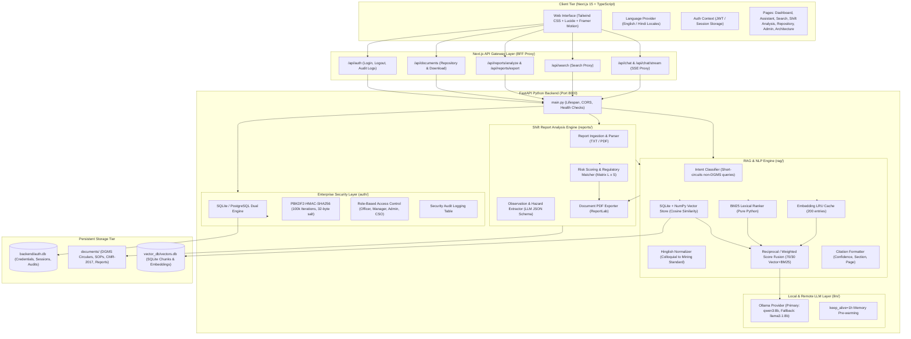

# DGMS Copilot — Comprehensive System Architecture & Technical Specification

> **Target Audience**: AI models (e.g., ChatGPT, Claude), lead systems architects, security auditors, and full-stack engineers requiring an exhaustive, clause-level understanding of every module, algorithm, schema, and data flow in the **DGMS Copilot Platform**.

---

## 1. Executive Summary & Domain Context

**DGMS Copilot** is an enterprise-grade artificial intelligence regulatory compliance and operational safety assistant tailored specifically for India's coal mining industry, with direct operational alignment to **Coal India Limited (CIL)** and **Central Coalfields Limited (CCL)** workflows.

### 1.1 The Operational Problem
Coal mining in India is governed under strict statutory guidelines enforced by the **Directorate General of Mines Safety (DGMS)** under the Ministry of Labour and Employment. Compliance spans:
- **The Mines Act, 1952** (Statutory parent legislation)
- **Coal Mines Regulations (CMR), 2017** (Comprehensive operational rules)
- **Hundreds of DGMS Technical Circulars and Safety Notes** issued over decades
- **Mine-specific Standard Operating Procedures (SOPs)** for blasting, HEMM (Heavy Earth Moving Machinery), ventilation, conveyor operations, and electrical installations.

Mining personnel (Safety Officers, Colliery Managers, Overmen, Sirdars) work in high-risk operational environments where non-compliance leads to fatal accidents, statutory closure notices (Section 22 of Mines Act), and heavy financial liabilities. Traditional manual searches through unindexed PDFs and paper circulars are slow and error-prone.

### 1.2 The Solution
DGMS Copilot bridges this gap by providing:
1. **Verifiable Retrieval-Augmented Generation (RAG)**: Answers queries with clause-level citations (Source ID, Section, Page, Issuing Authority, Date).
2. **Hinglish / Roman Hindi Query Normalization**: Understood by field mining staff who query using colloquial Indian mining jargon (e.g., *"belt inspection kab karna hota hai"*).
3. **Automated Operational Shift Report Auditing**: Ingests raw shift logs, detects hazards and safety infractions, matches them against statutory DGMS circulars, assigns algorithmic risk scores, and generates downloadable PDF audit reports.
4. **Dual Database Enterprise Authentication**: Role-Based Access Control (RBAC) supporting SQLite (embedded mode) and PostgreSQL (production mode), complete with PBKDF2 password hashing and immutable audit logging.
5. **Zero-Dependency Vector Architecture**: A custom pure-Python SQLite + NumPy vector database requiring no external vector database servers or C++ compilation.

---

## 2. High-Level Architecture & Data Flows



---

## 3. Directory Structure & File Inventory

```
DGMS Copilot/
├── .env.example                     # Root environment template for Next.js
├── .gitignore                       # Production gitignore (excludes secrets, venvs, DBs)
├── eslint.config.mjs                # ESLint flat config
├── next-env.d.ts                    # Next.js TypeScript declarations
├── next.config.mjs                  # Next.js compilation settings
├── package.json                     # Frontend dependencies & npm scripts
├── postcss.config.mjs               # PostCSS & Tailwind processing
├── README.md                        # Quickstart documentation
├── tailwind.config.ts               # Custom styling tokens, animations & themes
├── tsconfig.json                    # Strict TypeScript compiler options
├── .vscode/
│   └── settings.json                # Python virtualenv & path overrides for VSCode
├── app/
│   ├── globals.css                  # Global styles, Tailwind directives, dark/light themes
│   ├── layout.tsx                   # Root HTML document wrapper with ThemeProvider & AuthProvider
│   ├── page.tsx                     # Landing & authentication portal
│   ├── (app)/                       # Authenticated application shell routes
│   │   ├── layout.tsx               # AppShell wrapper (Sidebar, Navigation, Top Bar)
│   │   ├── loading.tsx              # Fallback loading skeleton
│   │   ├── dashboard/page.tsx       # Main operations dashboard & KPI metrics
│   │   ├── assistant/page.tsx       # AI compliance assistant with real-time SSE streaming
│   │   ├── search/page.tsx          # Hybrid semantic/keyword document exploration
│   │   ├── shift-analysis/page.tsx  # Shift safety report parser, risk scoring & PDF export
│   │   ├── repository/page.tsx      # Controlled knowledge repository & approval manager
│   │   ├── citations/page.tsx       # Citation audit & verification workbench
│   │   ├── architecture/page.tsx    # Interactive pipeline architecture visualization
│   │   └── admin/page.tsx           # Officer access logs & governance settings
│   └── api/                         # Backend-For-Frontend Next.js proxy routes
│       ├── chat/route.ts            # Non-streaming chat proxy
│       ├── chat/stream/route.ts     # Server-Sent Events (SSE) streaming chat proxy
│       ├── search/route.ts          # Semantic search proxy
│       ├── notifications/route.ts   # System safety alerts proxy
│       ├── documents/
│       │   ├── route.ts             # Knowledge base document list proxy
│       │   └── [source_id]/download/route.ts # File download proxy
│       ├── reports/
│       │   ├── analyze/route.ts     # Multi-part file upload & shift analysis proxy
│       │   └── export/route.ts      # PDF audit report generation proxy
│       └── auth/
│           ├── login/route.ts       # Authentication proxy
│           ├── logout/route.ts      # Session termination proxy
│           ├── me/route.ts          # Authenticated officer profile proxy
│           ├── change-password/route.ts # Password change proxy
│           └── audit-logs/route.ts  # Security audit log proxy
├── backend/
│   ├── main.py                      # FastAPI application entry point, lifecycle & router mounting
│   ├── requirements.txt             # Python dependencies (FastAPI, NumPy, HTTPX, ReportLab, etc.)
│   ├── setup.bat                    # One-click Windows setup script (venv, dependencies, ingestion)
│   ├── start_backend.bat            # Fast startup batch script for backend
│   ├── start_server.py              # Server bootstrap with port fallback & sanity checks
│   ├── ingest_documents.py          # Offline document indexing & vector creation pipeline
│   ├── test_e2e.py                  # End-to-end integration test suite
│   ├── test_reports.py              # Shift report analysis test suite
│   ├── test_50_prompts.py           # 50-prompt validation & benchmark test suite
│   ├── .env.example                 # Backend environment variable template
│   ├── api/                         # FastAPI router modules
│   │   ├── __init__.py
│   │   ├── assistant.py             # Chat & SSE streaming endpoints
│   │   ├── search.py                # Semantic & keyword search endpoints
│   │   ├── reports.py               # Shift report ingestion, analysis & PDF export
│   │   ├── repository.py            # Document inventory & metadata endpoints
│   │   ├── notifications.py         # Statutory alert notifications endpoint
│   │   └── auth.py                  # Enterprise auth, session security & RBAC
│   ├── auth/
│   │   ├── __init__.py
│   │   └── db.py                    # Dual-engine DB (PostgreSQL + SQLite), PBKDF2 hashing & seed users
│   ├── citations/
│   │   ├── __init__.py
│   │   └── formatter.py             # Structured Citation object builder & confidence scoring
│   ├── embeddings/
│   │   ├── __init__.py
│   │   └── model.py                 # Embedding generation (Ollama / Local fallback)
│   ├── ingestion/
│   │   ├── __init__.py
│   │   ├── loader.py                # Text & PDF file reading with encoding detection
│   │   ├── metadata.py              # Statutory metadata extraction (DGMS numbers, dates, authorities)
│   │   └── chunker.py               # Clause-aware text chunking with sliding overlap
│   ├── llm/
│   │   ├── __init__.py
│   │   └── provider.py              # Ollama client with auto-fallback, streaming & keep_alive
│   ├── rag/
│   │   ├── __init__.py
│   │   ├── pipeline.py              # Orchestrates the 7-stage hybrid RAG pipeline
│   │   ├── bm25_index.py            # Pure Python BM25 inverted index for keyword search
│   │   ├── embedding_cache.py       # Thread-safe LRU cache for query and document vectors
│   │   ├── hinglish_normalizer.py   # Roman Hindi to mining English domain dictionary
│   │   └── intent_classifier.py     # Rule-based intent detection (greetings, out-of-domain, search)
│   ├── reports/
│   │   ├── __init__.py
│   │   ├── report_ingestion.py      # Shift report text normalization
│   │   ├── report_analysis.py       # LLM extraction of hazards, machinery & observations
│   │   ├── risk_scoring.py          # Matrix scoring (Likelihood x Severity) & DGMS mapping
│   │   ├── report_export.py         # Summary exporter formatting
│   │   └── doc_pdf_exporter.py      # Formatted PDF generator using ReportLab
│   ├── scripts/
│   │   └── generate_mock_corpus.py  # Generates synthetic DGMS circulars & SOPs
│   ├── utils/
│   │   ├── __init__.py
│   │   └── ollama_startup.py        # Probes Ollama service, verifies models & auto-starts if down
│   └── vectorstore/
│       ├── __init__.py
│       └── sqlite_store.py          # Pure Python SQLite + NumPy vector database
├── components/
│   ├── app-shell.tsx                # Master layout shell: sidebar, navigation, search modal
│   ├── charts.tsx                   # Donut charts, risk distribution bars, SVG visualizers
│   ├── command-palette.tsx          # Cmd+K / Ctrl+K quick navigation launcher
│   ├── document-card.tsx            # Visual card for regulatory documents & SOPs
│   ├── metric-card.tsx              # Dashboard statistic cards with status pills
│   ├── notification-center.tsx      # Dropdown sheet for high-priority DGMS alerts
│   ├── page-header.tsx              # Standardized header with eyebrow, title, and action buttons
│   ├── pdf-viewer.tsx               # Client-side PDF rendering modal using react-pdf
│   ├── profile-menu.tsx             # User profile, role indicator & logout modal
│   ├── theme-provider.tsx           # Next-themes wrapper for light/dark theme switching
│   ├── toast.tsx                    # Notification toaster
│   └── ui/                          # Reusable primitive UI components
│       ├── badge.tsx                # Color-coded status badge (Green, Amber, Red, Slate)
│       ├── button.tsx               # Accessible button with loading states & variants
│       ├── card.tsx                 # Composable container card
│       ├── input.tsx                # Styled text input
│       └── textarea.tsx             # Auto-resizing textarea
├── documents/                       # Source statutory corpus (Text format)
│   ├── dgms/                        # Official DGMS technical circulars & safety notes
│   ├── regulations/                 # Coal Mines Regulations 2017 & Mines Act 1952 excerpts
│   ├── reports/                     # Realistic shift inspection logs & safety audit reports
│   └── sops/                        # Central Coalfields Limited Standard Operating Procedures
├── lib/
│   ├── auth-context.tsx             # React AuthContext providing user state & login methods
│   ├── auth.ts                      # Role types, permissions, and helper checks
│   ├── chat-store.ts                # Client-side persistent chat history & active thread state
│   ├── platform-data.ts             # Static metadata, architecture stages, fallback circulars
│   ├── preference-store.ts          # User preferences (font size, UI density, sound alerts)
│   ├── utils.ts                     # Tailwind class merging (`clsx` + `twMerge`)
│   └── i18n/
│       ├── LanguageContext.tsx      # Language switcher context (en / hi)
│       └── localize.ts              # Translation helper functions
├── locales/
│   ├── en.json                      # English localization string dictionary
│   └── hi.json                      # Hindi (हिंदी) localization string dictionary
├── public/
│   ├── pdf.worker.min.js            # Web worker for fast client-side PDF rendering
│   └── docs/                        # Pre-compiled PDF files mirroring statutory text documents
└── vector_db/
    └── vectors.db                   # Pre-indexed SQLite database containing 126 embedded chunks
```

---

## 4. The Hybrid RAG Engine in Detail

The core retrieval engine lives in `backend/rag/` and `backend/vectorstore/`. It is engineered specifically to eliminate hallucinations and achieve deterministic latency on standard mining workstation hardware.

### 4.1 Stage 1: Intent Classification (`rag/intent_classifier.py`)
Incoming queries are classified before touching the vector database:
1. **`GREETING`** (*"Hello", "Namaste", "Good morning"*): Returns a canned bilingual welcome message without performing vector search or calling the LLM.
2. **`SMALLTALK`** (*"Who made you?", "What can you do?"*): Explains the system's capabilities immediately.
3. **`OUT_OF_DOMAIN`** (*"How to bake a cake", "Who won the cricket match"*): Refuses the query gracefully and redirects the user to mining safety topics.
4. **`REGULATORY_QUERY`**: Legitimate mining safety questions forwarded to the hybrid search pipeline.

### 4.2 Stage 2: Hinglish Normalization (`rag/hinglish_normalizer.py`)
Mining workers in India frequently communicate in a hybrid of Hindi written in the Latin alphabet and English technical terms.
- *Input*: `"belt conveyor ka inspection kab karna hota hai aur pull cord check ka rule kya hai"`
- *Action*: The normalizer applies regex patterns over question words, verbs, temporal terms, and mining equipment jargon.
- *Normalized Retrieval Query*: `"belt conveyor inspection frequency pull cord check requirement"`
- *Key Design Principle*: The normalized string is **only** used for vector embedding and BM25 search. The original prompt is preserved and sent to the LLM so the model responds naturally in the user's chosen language.

### 4.3 Stage 3: Embedding & Query Vector Cache (`rag/embedding_cache.py`)
- Computes dense embeddings using Ollama's embedding endpoint (`OLLAMA_MODEL` or `nomic-embed-text` / `all-minilm`).
- An in-memory, thread-safe LRU cache stores up to **200 recent query embeddings**, reducing repetitive vector calculation overhead to `0ms`.

### 4.4 Stage 4: Hybrid Retrieval (`rag/bm25_index.py` & `vectorstore/sqlite_store.py`)
Retrieval executes two parallel strategies:
1. **Dense Vector Search**:
   - Computes cosine similarity between the query vector and pre-normalized chunk embedding vectors stored in SQLite.
   - Performed via vectorized NumPy dot products:
     $$\text{Cosine Similarity} = \mathbf{Q} \cdot \mathbf{V}^T$$
2. **Lexical BM25 Search**:
   - An in-memory inverted index computes Okapi BM25 scores:
     $$\text{Score}(D, Q) = \sum_{i=1}^{N} \text{IDF}(q_i) \cdot \frac{f(q_i, D) \cdot (k_1 + 1)}{f(q_i, D) + k_1 \cdot \left(1 - b + b \cdot \frac{|D|}{\text{avgdl}}\right)}$$
     *(Parameters tuned for regulatory text: $k_1 = 1.5$, $b = 0.75$)*
3. **Score Fusion**:
   - Vector and BM25 scores are normalized to $[0, 1]$ and combined:
     $$\text{Final Score} = (0.70 \times \text{Vector Score}) + (0.30 \times \text{BM25 Score})$$
   - Documents are deduplicated by `source_id` + `section`, retaining only the highest-scoring passage.

### 4.5 Stage 5: Strict Anti-Hallucination Guardrail
- If the top fused score is below `NOT_FOUND_THRESHOLD` ($0.20$):
  The system **aborts LLM inference** and returns a strict statutory disclaimer:
  > *"I couldn't find enough information in the uploaded DGMS documents to answer this question. Please consult your mine's safety officer or visit the DGMS official website for guidance."*

### 4.6 Stage 6: Prompt Construction & LLM Generation (`llm/provider.py`)
- Top 3 retrieved chunks are compressed to $\le 380$ characters per chunk.
- Recent conversation turns (last 3 interactions) are appended to preserve dialogue continuity.
- System prompt instructs the model:
  - Base answers *strictly* on provided context.
  - Never fabricate circular numbers or regulations.
  - Cite specific clauses where applicable.
- Model generation is executed with a `1h` keep-alive via Ollama to prevent model unloading.
- Token streaming is delivered via Server-Sent Events (`/api/chat/stream`).

### 4.7 Stage 7: Citation Assembly (`citations/formatter.py`)
Every retrieved passage is converted into a structured `Citation` object:
```json
{
  "ref": "DGMS-CIR-2024-17 / Section 4.2",
  "title": "Safety Measures for Belt Conveyor Installations in Coal Mines",
  "source_id": "DGMS-CIR-2024-17",
  "source_type": "DGMS Circular",
  "section": "Emergency Stop and Pull Cord Switches",
  "page": 2,
  "publication_date": "2024-03-15",
  "issuing_authority": "Directorate General of Mines Safety, Dhanbad",
  "excerpt": "Pull cord switches shall be provided throughout the entire length of the conveyor at intervals not exceeding 30 meters...",
  "confidence": "High",
  "synthetic": false,
  "answerUse": "Source retrieved with high confidence from DGMS Circular."
}
```

---

## 5. Shift Report Analysis & Risk Scoring Engine

The module in `backend/reports/` processes daily operational shift reports from underground and open-cast coal mines.

### 5.1 Ingestion & Extraction (`reports/report_analysis.py`)
1. User uploads a text file or PDF shift report.
2. The LLM extracts entities under a strict JSON schema:
   - `equipment`: e.g., `["Dumper D-104", "Conveyor Belt #3", "Continuous Miner"]`
   - `locations`: e.g., `["Seam 4 East Heading", "Haul Road North", "Substation B"]`
   - `personnel`: e.g., `["Overman R.K. Sharma", "Mining Sirdar"]`
   - `dates`: Mentioned shift dates and times.
   - `safety_observations`: General notes on ventilation, water accumulation, dusting.
   - `hazards`: Specific safety violations or abnormal conditions observed.
   - `corrective_actions`: Actions taken or recommended by the shift in-charge.

### 5.2 Regulatory Matching & Risk Scoring (`reports/risk_scoring.py`)
For each detected hazard:
1. The hazard string is queried against the vector database to locate relevant DGMS circulars or Coal Mines Regulations.
2. The risk level is calculated:
   - **Low**: Housekeeping issues, minor documentation lapses.
   - **Medium**: Equipment wear without immediate failure risk, illumination deficiencies.
   - **High**: Conveyor pull cord inoperable, inadequate stone dusting in coal headings.
   - **Critical**: Inadequate ventilation below statutory limits, methane detector failure, missing berms on steep haul roads.
3. The overall report receives a compliance rating:
   - **Green**: 0 Critical, 0 High issues.
   - **Amber**: 1+ Medium issues, 0 Critical issues.
   - **Red**: 1+ High or Critical issues requiring immediate statutory intervention.

### 5.3 PDF Audit Report Export (`reports/doc_pdf_exporter.py`)
Generates an official, publication-quality compliance audit certificate:
- Built with Python `reportlab`.
- Contains official government header formatting: *Government of India / Directorate General of Mines Safety Compliance Review*.
- Executive summary, risk score breakdown, tabular listing of detected issues with cited DGMS regulations and mandated corrective actions.
- Formal sign-off blocks for the Mine Safety Officer and Colliery Agent.

---

## 6. Authentication, RBAC & Security Infrastructure

The authentication subsystem in `backend/auth/` implements zero-trust principles suited for government or enterprise intranets.

### 6.1 Database Abstraction (`backend/auth/db.py`)
Supports dual-database engines transparently:
- **Embedded Mode (Default)**: SQLite database stored at `backend/auth.db`.
- **Enterprise Mode**: PostgreSQL connection via `POSTGRES_URL` (uses `psycopg2`).

### 6.2 Password Hashing Specification
- Algorithm: **PBKDF2-HMAC-SHA256**
- Iteration Count: **100,000 iterations**
- Salt: **32 cryptographically secure random bytes** generated via `secrets.token_bytes(32)`.
- Storage Format: Hex-encoded hash and hex-encoded salt stored in separate columns.
- Comparison: Constant-time verification via `secrets.compare_digest`.

### 6.3 Pre-Seeded Officer Accounts
On initial boot, `backend/auth/db.py` creates default accounts:
| Username | Role | Full Name | Mining Unit | Security Clearance |
| :--- | :--- | :--- | :--- | :--- |
| `cso_officer` | `Safety Officer` | Chief Safety Officer | CCL — Ranchi HQ | Level 4 - Executive Command |
| `manager_karo` | `Colliery Manager` | Colliery Manager | Karo OCP, CCL | Level 3 - Operational Command |
| `admin` | `Administrator` | Platform Administrator | DGMS Technical Directorate | Level 5 - System Root |

### 6.4 Security Audit Trail (`audit_logs` table)
Every security-sensitive action logs an immutable record:
- Timestamp (Unix epoch integer)
- Action type (`LOGIN_SUCCESS`, `LOGIN_FAILURE`, `PASSWORD_CHANGE`, `REPORT_ANALYSIS`, `REGULATION_EXPORT`)
- Officer ID & Username
- IP Address & User Agent
- Status & Error Detail

---

## 7. Zero-Dependency Vector Database (`vectorstore/sqlite_store.py`)

Rather than requiring heavy, platform-dependent external dependencies (such as ChromaDB, Pinecone, or Milvus), DGMS Copilot includes an embedded pure-Python vector database backed by SQLite and NumPy.

### 7.1 Database Schema
```sql
CREATE TABLE IF NOT EXISTS chunks (
    id TEXT PRIMARY KEY,
    source_id TEXT NOT NULL,
    source_type TEXT NOT NULL,
    title TEXT NOT NULL,
    section TEXT NOT NULL,
    page INTEGER NOT NULL,
    content TEXT NOT NULL,
    embedding BLOB NOT NULL,
    token_count INTEGER NOT NULL,
    publication_date TEXT,
    issuing_authority TEXT,
    synthetic INTEGER DEFAULT 0
);

CREATE INDEX IF NOT EXISTS idx_chunks_source_id ON chunks (source_id);
CREATE INDEX IF NOT EXISTS idx_chunks_source_type ON chunks (source_type);
```

### 7.2 Storage & Retrieval Mechanics
- **Vectors as Binary BLOBs**: Embedding vectors (e.g., 768 or 1536 float32 values) are converted to raw bytes via `numpy.ndarray.tobytes()` and written directly into SQLite BLOB fields.
- **In-Memory Matrix Pre-normalization**: On server startup, all chunk vectors are loaded into a single 2D NumPy array $\mathbf{M} \in \mathbb{R}^{N \times D}$ and normalized such that $\|\mathbf{M}_i\|_2 = 1$.
- **Sub-10ms Cosine Search**: A query vector $\mathbf{q}$ is normalized to unit length, and similarity is computed in a single vectorized BLAS operation:
  $$\mathbf{S} = \mathbf{M} \cdot \mathbf{q}^T$$
  Top-$k$ indices are extracted using `numpy.argpartition` or `numpy.argsort`.

---

## 8. Complete API Specification

### 8.1 Backend Endpoints (FastAPI — Port 8000)

| Method | Endpoint | Description | Request Body / Query | Response Summary |
| :--- | :--- | :--- | :--- | :--- |
| `GET` | `/health` | Healthcheck & Vector count | None | `{"status": "ok", "vectorstore_count": 126}` |
| `POST` | `/api/chat` | Non-streaming RAG question | `{"question": str, "history": list}` | `{"answer": str, "citations": list, "intent": str}` |
| `POST` | `/api/chat/stream` | Real-time SSE streaming RAG | `{"question": str, "history": list}` | `text/event-stream` chunks with tokens and final citation payload |
| `GET` | `/api/search` | Hybrid semantic search | `?q=query&top_k=5&source_type=...` | `[{"source_id": str, "section": str, "score": float, ...}]` |
| `GET` | `/api/repository` | Document metadata inventory | None | List of indexed documents with approval states |
| `GET` | `/api/repository/{source_id}/download` | Download statutory PDF | Path parameter: `source_id` | File download (PDF) |
| `POST` | `/api/reports/analyze` | Shift report hazard analysis | `multipart/form-data` with `file` | `{"extracted_data": {...}, "compliance_data": {...}}` |
| `POST` | `/api/reports/export` | Download safety audit PDF | `{"report_data": {...}}` | Binary PDF stream |
| `GET` | `/api/notifications` | Active high-risk alerts | None | List of recent safety bulletins and violations |
| `POST` | `/api/auth/login` | Officer authentication | `{"username": str, "password": str}` | `{"token": str, "user": {...}}` |
| `POST` | `/api/auth/logout` | Session revocation | `Authorization: Bearer <token>` | `{"success": true}` |
| `GET` | `/api/auth/me` | Fetch active officer profile | `Authorization: Bearer <token>` | Officer profile object |
| `POST` | `/api/auth/change-password` | Update account password | `{"current_password": str, "new_password": str}` | `{"success": true}` |
| `GET` | `/api/auth/audit-logs` | Fetch security audit trail | Admin token required | List of audit log records |

### 8.2 Next.js API Routes (Frontend BFF — Port 3000)
Next.js acts as an API gateway, proxying requests from the browser to the backend while handling graceful degradation if the backend is temporarily offline:
- `POST /api/chat/stream` $\rightarrow$ Proxies Server-Sent Events with `duplex: 'half'`.
- `POST /api/reports/analyze` $\rightarrow$ Proxies file upload with extended 120s timeout.
- `POST /api/reports/export` $\rightarrow$ Proxies generated PDF streams directly to the browser.
- `GET /api/documents` $\rightarrow$ Merges live backend documents with offline fallback data from `lib/platform-data.ts`.

---

## 9. Frontend Architecture & User Interface

The frontend is built on **Next.js 15 (App Router)** and styled using **Tailwind CSS** with **Radix UI** primitives and custom engineering-grade components.

### 9.1 Application Shell (`components/app-shell.tsx`)
- Persistent collapsible sidebar with navigation links:
  - **Compliance Operations Center** (`/dashboard`)
  - **Compliance Assistant** (`/assistant`)
  - **DGMS Search** (`/search`)
  - **Shift Report Analysis** (`/shift-analysis`)
  - **Knowledge Repository** (`/repository`)
  - **Citation Traceability** (`/citations`)
  - **System Architecture** (`/architecture`)
  - **Security & Admin** (`/admin`)
- Quick Navigation Command Palette (`Ctrl + K` / `Cmd + K`).
- Global Language Switcher (English $\leftrightarrow$ Hindi).
- Real-time notification drawer displaying active DGMS circular alerts.

### 9.2 Bilingual Internationalization (`lib/i18n/`)
- Supports full English and Hindi UI translation.
- `LanguageContext.tsx` stores language selection in browser storage and provides a hook:
  ```typescript
  const { t, lang, setLang } = useLanguage();
  ```
- Localized dictionaries in `locales/en.json` and `locales/hi.json` cover navigation, safety alerts, form fields, and error messages.
- `lib/i18n/localize.ts` handles transliteration and document title translation.

---

## 10. Local Development & Operational Setup

### 10.1 Prerequisites
- **Node.js**: Version 18.18 or higher (Node 20+ recommended).
- **Python**: Version 3.9 or higher (Python 3.11 / 3.13 tested).
- **Ollama**: Installed from [ollama.com](https://ollama.com).

### 10.2 Ollama Model Setup
Pull the primary and fallback LLM models:
```bash
ollama pull qwen3:8b
ollama pull llama3.1:8b
```

### 10.3 Backend Setup
```powershell
cd backend
python -m venv venv
.\venv\Scripts\activate
pip install -r requirements.txt
python ingest_documents.py
python main.py
```
*Backend starts on `http://127.0.0.1:8000`.*

### 10.4 Frontend Setup
```powershell
# In the project root:
npm install
npm run dev:frontend
```
*Frontend opens on `http://localhost:3000`.*

### 10.5 Unified Development Command
Run both services concurrently:
```bash
npm run dev
```

---

## 11. Testing & Benchmark Verification

The repository includes comprehensive automated test suites in `backend/`:
1. **`test_e2e.py`**: Validates the end-to-end RAG flow, verifying that queries retrieve valid chunks, citations match expected schemas, and LLM responses include citations.
2. **`test_reports.py`**: Tests shift report parsing with sample logs (`incomplete-report.txt`, `critical-incident-report.txt`, `safe-report.txt`), verifying hazard extraction and risk scoring accuracy.
3. **`test_50_prompts.py`**: Executes a 50-question benchmark across all DGMS domains (ventilation, conveyors, explosives, HEMM, electrical, statutory forms), logging average latency, timeout percentage, and citation precision.

---

## 12. Key Extensibility & Scale Points for Future Engineering

When deploying DGMS Copilot from pilot stage to a company-wide CIL deployment:
1. **Vector Store Scaling**: Replace `backend/vectorstore/sqlite_store.py` with **Qdrant** or **pgvector** using the identical public interface (`add_chunks`, `search`, `count`, `reset`).
2. **PostgreSQL Migration**: Set `USE_POSTGRES=true` and provide `POSTGRES_URL` in `backend/.env`. All authentication tables, active sessions, and audit logs will automatically transition from SQLite to PostgreSQL.
3. **Model Fine-Tuning**: Adapt the Ollama endpoint to a fine-tuned LoRA model trained specifically on DGMS inquiry reports and Coal Mines Regulations case law.
4. **OCR Pipeline for Legacy Circulars**: Integrate Tesseract or PaddleOCR into `backend/ingestion/loader.py` for automatic ingestion of scanned paper circulars dating back to the 1960s.
